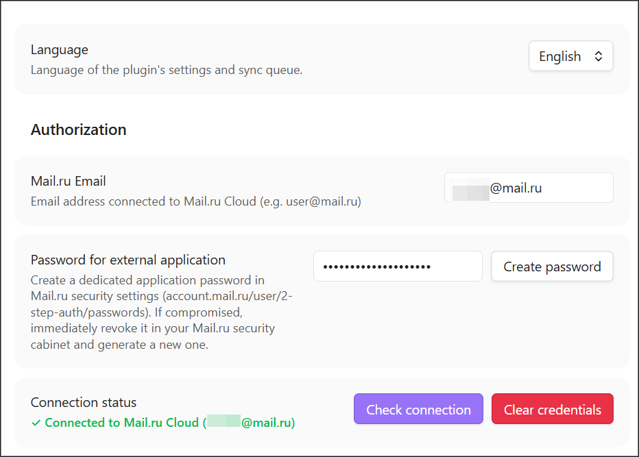
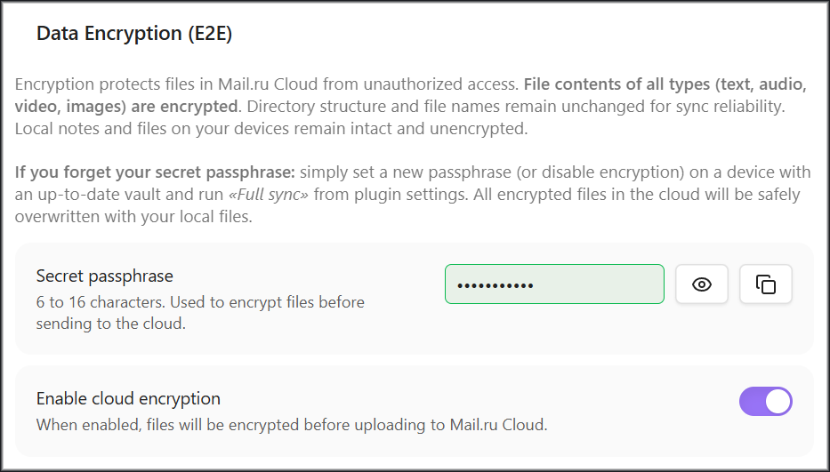
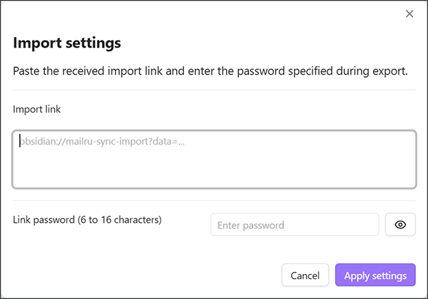

# ☁️ Mail.ru Cloud Sync for Obsidian

**English** • [Русская версия](README_RU.md)

An [Obsidian](https://obsidian.md) plugin for synchronizing your vault notes and attachments via **Mail.ru Cloud (WebDAV)**, featuring **End-to-End Encryption (E2E)**, accidental deletion protection, and seamless settings transfer between devices.

> 💡 *This project is built upon the open-source [Yandex Disk Sync](https://github.com/Nikolay-Eltsov/obsidian-yadisk-sync) plugin by [Nikolay Eltsov](https://github.com/Nikolay-Eltsov), adapted for Mail.ru Cloud WebDAV protocol, and extended with AES-256-GCM End-to-End Encryption and encrypted link configuration transfer.*

---

## 🌟 Key Features

- 🚀 **Direct WebDAV Synchronization**: Connects directly to official Mail.ru Cloud servers without third-party proxies.
- 🔐 **End-to-End Encryption (AES-256-GCM)**: Protects the contents of notes and attachments before uploading to the cloud.
  - Files are encrypted before uploading to the Cloud using AES-256-GCM with key derivation via PBKDF2 (SHA-256, 100,000 iterations).
  - Folder structure and file names remain intact for reliable synchronization.
  - Local files on your devices remain unencrypted in their original state.
  - **Fail-Fast Encrypted Vault Guard**: If encrypted files are detected in the cloud while the local secret passphrase is not set or encryption is disabled, synchronization stops immediately to protect the local vault from corruption. Sync resumes once encryption settings are configured on this device.
- 📲 **Instant Settings Transfer via Link**:
  - Quickly transfer all plugin parameters (including credentials and secret passphrase) to a phone, tablet, or another computer with a single click using a secure link `obsidian://mailru-sync-import?data=...`.
  - Link payload is encrypted with a separate temporary password (6 to 16 characters).
- 🛡️ **Intelligent Data Loss Protection**:
  - **Mass Deletion Protection**: If a sync operation would delete more files than the configured threshold (or over 25% of the vault), synchronization pauses automatically and asks for confirmation.
- ⚡ **Bidirectional Sync & Flexible Conflict Resolution**:
  - Sync direction options: Bidirectional, Push only, or Pull only.
  - Conflict resolution strategies: Newer wins, Local wins, Remote wins, or Manual prompt.
  - Automatic scheduled sync (intervals from 10 seconds to 1 hour).
- 🌍 **Full Bilingual Localization**: Complete interface available in English and Russian.

---

## 📸 Interface Screenshots

#### General Settings & Connection Status

*Figure 1: Settings tab, colored connection verification, and sync options.*

#### End-to-End Encryption (E2E) Section

*Figure 2: Setting secret passphrase and enabling AES-256-GCM encryption.*

#### Settings Export & Transfer Dialog

*Figure 3: Transferring settings across devices via password-protected encrypted link.*

---

## 📦 Installation

### Method 1: Via Official Obsidian Community Plugins (Recommended)
1. Open Obsidian **Settings** → **Community plugins**.
2. Click **Browse** and search for **`Mail.ru Cloud Sync`**.
3. Click **Install**, then click **Enable**.

*(Or click this direct link to open the plugin in Obsidian: [Add Mail.ru Cloud Sync to Obsidian](obsidian://show-plugin?id=mailru-cloud-sync)).*

### Method 2: Manual Installation via GitHub Releases
1. Go to the [GitHub Releases](https://github.com/scenthron/obsidian-mailru-cloud-sync/releases) page and download **`mailru-cloud-sync.zip`** (or the 3 individual files: `main.js`, `manifest.json`, `styles.css`) from the latest release.
2. Extract the archive into your vault's hidden plugins directory: `.obsidian/plugins/` (resulting in `.obsidian/plugins/mailru-cloud-sync/` containing the plugin files).
3. Reload Obsidian (or press `Ctrl + R`), go to **Settings** → **Community plugins**, and enable **Mail.ru Cloud Sync**.

---

## 🚀 Quick Start

### 1. Generating an Application Password in Mail.ru
For secure WebDAV access, Mail.ru requires creating a dedicated application password (never enter your primary account password):

1. Open Mail.ru security settings: [Application Passwords](https://account.mail.ru/user/2-step-auth/passwords).
2. Click **Add password** (or "Create").
3. Enter a label, for example: `Obsidian Sync`.
4. Immediately copy and save the generated 16-character password: it cannot be viewed again in Mail.ru — you can only delete it and generate a new one.

### 2. Configuring the Plugin in Obsidian
1. Open **Obsidian Settings** → **Mail.ru Cloud Sync**.
2. In the **Mail.ru Email** field, enter your email address (e.g. `user@mail.ru`).
3. In the **Password for external application** field, paste your generated application password (Important: enter the dedicated application password created in step 1, not your primary email password).
4. Click **Check connection**.
   - Upon successful verification, the status indicator will turn green: `✓ Connected to Mail.ru Cloud (user@mail.ru)`.
5. Specify the remote folder path (default: `/ObsidianVault`). The plugin will create it automatically in Mail.ru Cloud upon first sync.

---

## ⌨️ Plugin Commands (Command Palette / Hotkeys)

In Obsidian, press `Ctrl + P` (`Cmd + P` on macOS) to invoke commands, or assign custom shortcuts in **Settings → Hotkeys**:

| Command | Action Description |
| :--- | :--- |
| **Sync now** | Runs bidirectional sync. Instant when Mail.ru Cloud reports no changes. Can also be triggered by clicking the status bar icon. |
| **Full sync: read Mail.ru Cloud and the vault again** | Re-reads the remote folder and local vault from scratch without relying on cached snapshots. Useful for recovery and state reconciliation. |
| **Push all** | One-way upload of all local vault files to Mail.ru Cloud. |
| **Pull all** | One-way download of all files from Mail.ru Cloud to the local vault. |
| **Abort sync** | Immediately terminates the ongoing sync process. |
| **Show sync queue** | Opens the sidebar view showing transferring files, upcoming items, and sync history. |
| **Show sync status** | Displays the floating progress and failure indicator notice. |

---

## 🔐 Setting Up End-to-End Encryption (E2E)

To protect your files from unauthorized access:
1. In the **Data Encryption (E2E)** section, enter a strong **Secret passphrase** (6 to 16 characters).
2. Toggle on **Enable cloud encryption** and read the informational dialog.
3. Click the **«Upload to Cloud»** button to force update and encrypt all files in the cloud from this device.
4. On your other devices, simply enter the same passphrase and turn on the toggle (or transfer settings via secure link). The device will automatically download and decrypt your notes from the cloud!

> 💡 **Tip:** Keep your secret passphrase safe! Accessing your notes from other devices requires entering the exact same passphrase (or transferring it via the export link).

---

## 📲 Transferring Settings to Mobile, Tablet, or PC

You don't need to manually type long passwords and folder paths on your phone or tablet:
1. On your configured device, click **Export settings**.
2. Set a link password (6 to 16 characters) and click **Generate link**.
3. Click **Copy import link** and send it to your other device through a secure channel (e.g. "Saved Messages" in Telegram).
4. On the destination device:
   - Either **click the link** (Obsidian opens automatically and prompts for the link password).
   - Or open plugin settings, click **Import settings**, paste the link, and enter the password.
5. All credentials, paths, and encryption parameters will be applied instantly!

---

## 🛡️ Security & Privacy

- The plugin **does not** collect telemetry or send data to any third-party analytics servers.
- All network requests are routed exclusively to the official secure Mail.ru Cloud WebDAV endpoint (`https://webdav.cloud.mail.ru`) over encrypted HTTPS.
- Credentials are saved locally inside your vault configuration (`.obsidian/plugins/mailru-cloud-sync/data.json`).
- If an application password is ever compromised, you can revoke it immediately in your [Mail.ru security cabinet](https://account.mail.ru/user/2-step-auth/passwords) in a single click.

---

## 📜 License & Credits

This plugin is distributed under the open-source **MIT License**. For full details, see [LICENSE](LICENSE).

### Credits
This project is developed based on the open-source [Yandex Disk Sync](https://github.com/Nikolay-Eltsov/obsidian-yadisk-sync) plugin by [Nikolay Eltsov](https://github.com/Nikolay-Eltsov). We express our sincere gratitude to the author for the synchronization engine architecture, three-way merge logic, and queue implementation. You can find additional helpful information on the author's project page.

This version provides adaptation for the Mail.ru Cloud WebDAV protocol, integrated client-side AES-256-GCM End-to-End Encryption, secure encrypted-link configuration transfer, and full bilingual localization.

Development and adaptation of this project were carried out by **Centhron** in close collaboration with Superintelligence technologies (SI pair programming).
